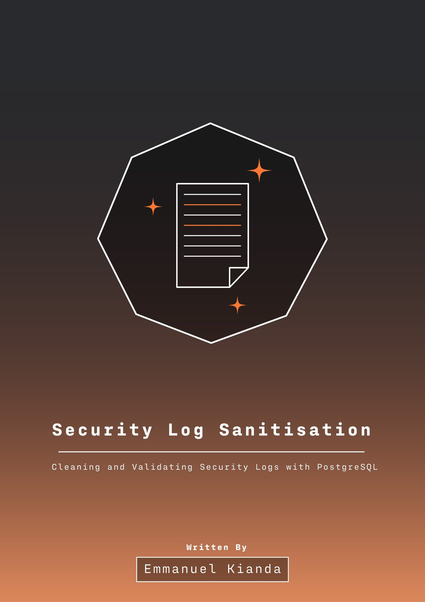

# Security Log Sanitisation

### Cleaning and Validating Security Logs with PostgreSQL

**SQL data cleaning project** | PostgreSQL • data sanitisation • data quality testing • security analytics • GitHub Actions

## Overview

Northbridge Logistics (a fictional UK company) collects security logs from four systems: an HR directory, sign-in events from two domain controllers and Microsoft Entra ID, a VPN appliance and a perimeter firewall. Each system exports data in its own format, with placeholders, duplicates, mixed time zones and inconsistent spellings.

This project answers one question:

**Can the security team trust detections built on these logs, and what does it take to make them trustworthy?**

All cleaning, validation, auditing and detection is written in **pure PostgreSQL**. Python is used only to generate the raw data.

> **Data note:** All records are simulated by `src/generate_data.py` with a fixed seed. No real people, companies or systems are involved. Five attack patterns are deliberately planted in the logs so the detections can be checked against a known answer.

## Headline result

The same five detection rules were run on the raw exports and on the sanitised data.

| Planted incident | Found on raw data | Found on clean data |
| --- | :---: | :---: |
| Brute force against one account (45 failures in 12 minutes) | ❌ | ✅ |
| Password spray (35 accounts from one IP in 25 minutes) | ❌ | ✅ |
| Three leavers still signing in after their leave date | ❌ 0 of 3 | ✅ 3 of 3 |
| Impossible travel (UK then Nigeria, 35 minutes apart) | ✅ | ✅ |
| Malware beaconing (port 4444 every 60 seconds for 6 hours) | ❌ | ✅ |
| **Total** | **1 of 7** | **7 of 7** |

Clean detections raise **no false alarms**: every alert matches a planted incident. A common companion check, "users connecting from more than one country", flags **78 users** on raw data (mostly `GB` vs `UK` vs `United Kingdom`) and **6** on clean data: 5 genuine business trips plus the attacker.

**Dirty data didn't just add noise: it hid attacks.**

## Why the raw data fails

| Problem in the raw data | Example | Effect on detection |
| --- | --- | --- |
| One account, many spellings | `CORP\mpatel`, `mpatel@northbridge.co.uk`, ` MPatel ` | 45 failures split into groups of under 10, below the brute-force threshold |
| Different result codes per system | `4625`, `4771`, `50126`, `Failure`, `FAILED` | Filtering on the obvious value misses most failures |
| UK dates on a US-configured server | `11/10/2026` read as 10 November | Leavers appear to still be employed |
| Five timestamp formats | UK local time, epoch seconds, epoch milliseconds, ISO 8601, syslog with no year | Events can't be ordered or compared without parsing |
| Port written several ways | `4444`, `tcp/4444`, `4444/TCP`, ` 4444` | Beacon traffic split into irregular fragments |
| Country written several ways | `GB`, `UK`, `U.K.`, `GBR`, `United Kingdom` | Every UK user looks like a traveller |

## Data cleaning in numbers

**100,914 raw rows** across 4 sources. Every row ends up in exactly one place: the clean table or quarantine (with its reason).

| Source | Raw rows | Duplicates removed | Quarantined | Clean rows |
| --- | ---: | ---: | ---: | ---: |
| HR directory | 248 | 6 | 2 | 240 |
| Sign-in events | 17,006 | 333 | 51 | 16,622 |
| VPN sessions | 800 | 40 | 7 | 753 |
| Firewall logs | 82,860 | 500 | 3,051 | 79,309 |

Distinct values before and after standardisation:

| Field | Raw | Clean |
| --- | ---: | ---: |
| Usernames in sign-in events | 1,954 | 242 |
| Sign-in result values | 11 | 2 |
| Departments | 31 | 8 |
| Employment status values | 10 | 2 |
| VPN countries | 15 | 6 |
| Firewall port values | 39 | 9 |
| Firewall actions | 10 | 2 |

## Pipeline design

```text
data/raw/*.csv
     │  \copy, every column TEXT
     ▼
 raw.*  ──► clean.parse_*() safe-parse functions + ref.value_map ──► clean.*  ──► detect.*
                                     │                                  │
                                     ▼                                  ▼
                           quarantine.records                       audit.*
                        (rejected rows + reason)        (reconciliation, unmapped values, before/after)
```

| Schema | Purpose |
| --- | --- |
| `raw` | Exactly what the systems exported. All `TEXT`, so no bad value is rejected or coerced on load |
| `ref` | Settings and value maps (every accepted spelling of a category, mapped to one standard value) |
| `clean` | Typed, standardised, deduplicated tables with `CHECK`, `UNIQUE` and foreign-key constraints |
| `quarantine` | Rejected rows, kept as JSON with the reason, so nothing disappears silently |
| `audit` | Reconciliation, quarantine summary, unmapped values, before/after distinct counts |
| `detect` | Five detections on clean data, the same five on raw data, and a scorecard |

## Key cleaning decisions

The full reasoning for every rule is in [`docs/cleaning_decisions.md`](docs/cleaning_decisions.md).

- **Load everything as text first.** A typed column would reject or silently coerce bad values on load. Text keeps every value visible, so each one is handled by an explicit rule.
- **Safe-parse functions that never error.** `clean.parse_event_time()`, `parse_inet()`, `parse_uk_date()`, `parse_bytes()` and `parse_port()` return `NULL` for anything they can't trust. The caller decides whether that means quarantine or a flag.
- **Match each format explicitly; never rely on server settings.** UK dates are parsed field by field, so results are identical on a server with US date settings. UK local times are converted from `Europe/London`, including the 25 October clock change.
- **Value maps as data, not `CASE` statements.** 69 mappings live in `ref.value_map`, where they can be reviewed. Unknown spellings are never guessed: they appear in `audit.unmapped_values`.
- **Quarantine, don't delete.** Rejected rows are stored with their reason and original content.
- **Don't clean away the signal.** Sign-ins to accounts that don't exist (`admin`, `test`) are **kept** and labelled `unknown_account`: dropping them would hide the password spray. Sign-ins with an unusable IP are kept with the IP set to `NULL` and a flag, because the sign-in still happened.
- **Don't invent data.** VPN sessions that end before they start are quarantined, not swapped, because nothing says which timestamp is wrong.

## Automated tests

`sql/11_tests.sql` runs **16 tests** on every build. Any failure stops the run with an error. Tests run on every push via GitHub Actions against a fresh PostgreSQL 17 database.

- **Completeness:** every raw row is clean or quarantined, never both; every categorical value has a mapping
- **Validity:** times inside the reporting period, canonical usernames, unique events, consistent IP flags, valid ports, ISO country codes
- **Edge cases:** UK clock change, US date settings, 31 February, zero-padded and IPv6-mapped addresses
- **Outcome:** every planted incident is detected, and no other alerts are raised

## Run locally (macOS)

**1. Install and start PostgreSQL**

```bash
brew install postgresql@17
brew services start postgresql@17
echo 'export PATH="/opt/homebrew/opt/postgresql@17/bin:$PATH"' >> ~/.zshrc
source ~/.zshrc
createdb seclogs
```

**2. Run the pipeline from the project folder**

```bash
cd security-log-sanitisation
psql -d seclogs -f sql/run_all.sql
```

This rebuilds everything from scratch in about 10 seconds: it loads the raw CSVs, cleans them, runs the tests, prints the scorecard and writes results to `reports/`. Safe to run repeatedly.

**3. Explore**

```bash
psql -d seclogs
```

```sql
SELECT * FROM detect.scorecard;
SELECT * FROM audit.quarantine_summary;
SELECT * FROM detect.brute_force;
```

Optional: regenerate the raw data with `python3 src/generate_data.py` (standard library only, no installs).

## Repository structure

```text
src/generate_data.py            → simulated raw exports with planted incidents
data/raw/                       → the four messy source files
data/ground_truth/              → the planted incidents (the answer key)
sql/run_all.sql                 → runs the whole pipeline in order
sql/01_schemas.sql              → schemas, settings, quarantine table
sql/02_load_raw.sql             → loads CSVs into raw tables as text
sql/03_functions.sql            → safe-parse functions
sql/04_value_maps.sql           → standard values for every categorical field
sql/05_clean_hr.sql … 08_*.sql  → one cleaning script per source
sql/09_audit.sql                → reconciliation and data quality views
sql/10_detections.sql           → detections on clean and raw data, scorecard
sql/11_tests.sql                → 16 automated tests
sql/12_export_reports.sql       → writes results to reports/
reports/                        → exported results (CSV)
docs/cleaning_decisions.md      → reasoning behind every rule
docs/images/                    → cover image
.github/workflows/tests.yml     → CI: runs the full pipeline and tests on every push
```

## Limitations

- The data is simulated. Detection thresholds (10 failures in 15 minutes, 15 accounts in 30 minutes, under 2 hours between countries, gap variation under 0.25) are illustrative and would be tuned on real traffic.
- Impossible travel uses country only, not distance or travel time.
- Syslog timestamps carry no year; the export year is assumed, with a rollback rule for dates after the export.
- Firewall duplicates are detected by matching every field, because the firewall log has no event ID.

## Conclusion

This project demonstrates how data sanitisation directly impacts the reliability of security monitoring and threat detection. Using PostgreSQL, I developed a reproducible pipeline to clean, standardise, validate and audit 100,914 security log records from four different sources, while preserving rejected records for investigation.

The results highlighted the importance of data quality. Before sanitisation, the detection rules identified only 1 of 7 planted incidents. After cleaning, all 7 incidents were successfully detected with no false positives. This showed how inconsistent formats, duplicate records and unreliable values can cause genuine security threats to go unnoticed.

Beyond data cleaning, the project strengthened my practical skills in SQL, PostgreSQL, data validation, reconciliation, automated testing and security analytics. By implementing 16 automated tests and integrating GitHub Actions, I also ensured that the pipeline remained consistent, repeatable and verifiable.

Overall, this project reinforced a key principle: reliable analysis starts with reliable data. Even well-designed detection rules can produce misleading results if the underlying data is inaccurate or inconsistent.
